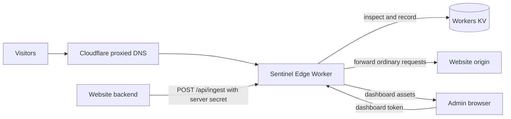

# Architecture

## Request flow

Alias hostnames route to one Worker and one configured origin. The Worker checks each website request for its configured heuristic signals, records a detection when a signal matches, and proxies the request to `ORIGIN_URL`. In block mode, recognized path probes and scanner signatures receive a 403 response.

The dashboard is served at `/_sentinel`. Its read and acknowledgement APIs require `DASHBOARD_TOKEN`. Website application events are sent server-to-server to `POST /api/ingest` with `AUDIT_INGEST_TOKEN`; the browser must never receive that secret.

## Data scope

The Worker does not automatically record every request or infer user actions inside the application. Its detection stream contains requests matching the built-in heuristic checks. The application audit stream contains only events the website backend explicitly submits. KV provides a short-lived operational view, not a durable or tamper-evident compliance archive.
